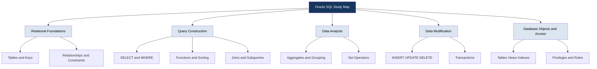
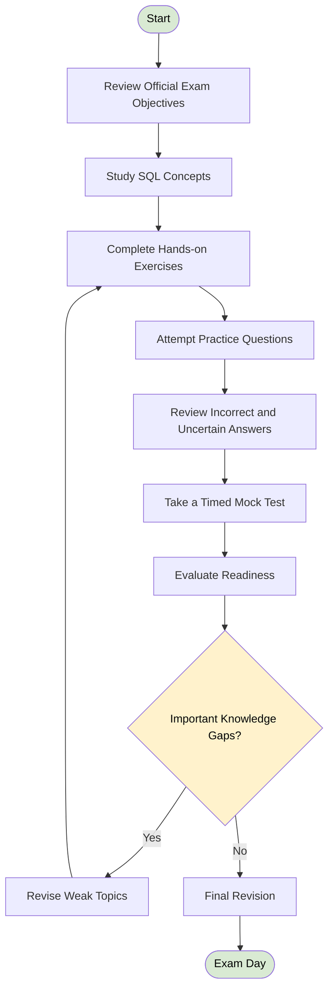
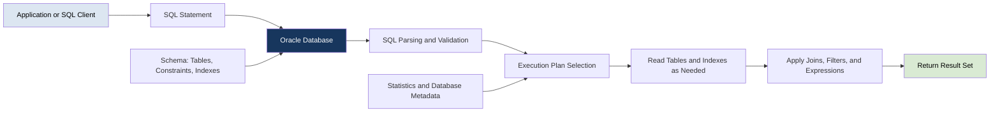
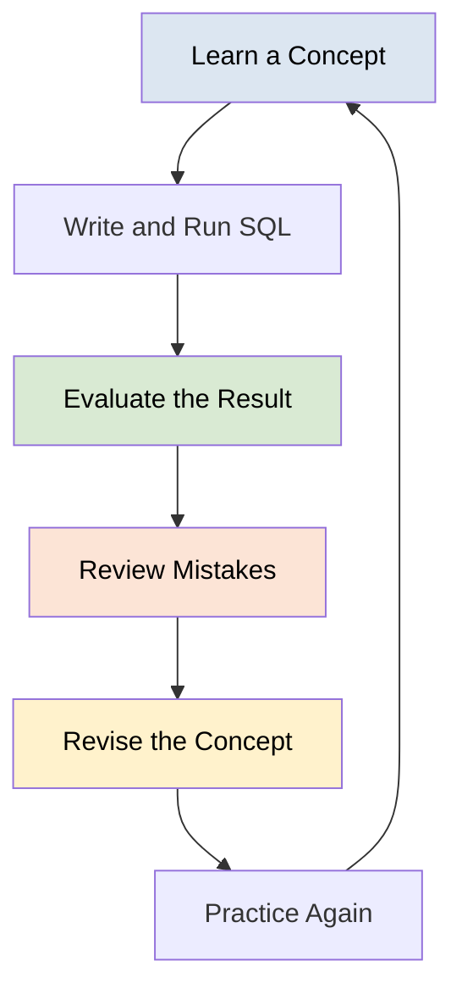
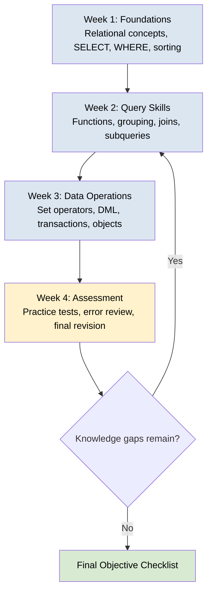

# Oracle Database SQL (1Z0-071) — Study Guide and Practice Questions

Prepare for the **Oracle Database SQL (1Z0-071)** certification with a practical learning guide covering SQL fundamentals, filtering, joins, subqueries, functions, data manipulation, transactions, and database objects.

This repository combines structured study recommendations, Oracle documentation, original practice questions, hands-on exercises, and Mermaid diagrams to help learners understand how Oracle SQL works—not just memorize syntax.

> **Study principle:** Learn the concept, write the SQL, inspect the result, explain the behavior, and revisit mistakes before moving on.

**Exam:** Oracle Database SQL  
**Exam code:** `1Z0-071`  
**Provider:** Oracle  
**Certification:** Oracle Database SQL Certified Associate  
**Official exam information:** [Oracle MyLearn](https://mylearn.oracle.com/exam)  
**Supplementary preparation:** [CertsGate](https://certsgate.com/)

---

## Table of Contents

- [About the Certification](#about-the-certification)
- [Who Should Prepare?](#who-should-prepare)
- [Exam Details](#exam-details)
- [Skills and Knowledge Areas](#skills-and-knowledge-areas)
- [Exam Objectives and Skills Map](#exam-objectives-and-skills-map)
- [Certification Preparation Flowchart](#certification-preparation-flowchart)
- [Oracle SQL Query Architecture](#oracle-sql-query-architecture)
- [Circular Study and Revision Cycle](#circular-study-and-revision-cycle)
- [Step-by-Step Preparation Guide](#step-by-step-preparation-guide)
- [Recommended Study Schedule](#recommended-study-schedule)
- [Practice Questions](#practice-questions)
- [Hands-On SQL Projects](#hands-on-sql-projects)
- [Common Preparation Mistakes](#common-preparation-mistakes)
- [Career Relevance](#career-relevance)
- [Frequently Asked Questions](#frequently-asked-questions)
- [Official and Additional Learning Resources](#official-and-additional-learning-resources)
- [About CertsGate](#about-certsgate)
---

## About the Certification

The Oracle Database SQL certification focuses on the ability to work with relational data using Oracle SQL. It is relevant to people who need to retrieve information, combine data from multiple tables, perform calculations, manipulate records, and understand database objects.

SQL is more than a collection of commands. A reliable SQL practitioner must understand how conditions affect returned rows, how joins relate records, how aggregate functions summarize data, and how transaction statements affect changes.

This **1Z0-071 study guide** is designed to support that practical understanding. Use it alongside the current Oracle exam objectives and official documentation rather than treating this repository as a replacement for them.

## Who Should Prepare?

This certification may be relevant to:

- **Aspiring database developers** learning to write queries against relational databases.
- **Database administrators** who need a stronger foundation in SQL.
- **Data analysts** who retrieve, filter, combine, and summarize business data.
- **Application developers** who interact with Oracle Database from software applications.
- **Students and career changers** building foundational database skills.

Previous experience with relational tables, primary keys, foreign keys, and basic SQL is useful. Beginners can still use this guide, but they should spend additional time practicing simple queries before moving into complex joins and subqueries.

## Exam Details

| Item | Information |
|---|---|
| Exam name | Oracle Database SQL |
| Exam code | 1Z0-071 |
| Certification | Oracle Database SQL Certified Associate |
| Certification provider | Oracle |
| Official exam portal | [Oracle MyLearn](https://mylearn.oracle.com/exam) |
| Exam duration | Check the current official listing |
| Question count | Check the current official listing |
| Passing score | Check the current official listing |
| Domain weightings | Use the current official objectives if published |

Exam policies and delivery details can change. Confirm the English-language 1Z0-071 listing in Oracle MyLearn before scheduling your exam. Do not assume that specifications for a localized version of an exam necessarily apply to the English version.

---

## Skills and Knowledge Areas

The following topics form a practical study map for Oracle SQL. Use the current official exam objectives to determine which subjects are included in your exam version.

| Knowledge area | What to understand | Suggested practice |
|---|---|---|
| Relational database concepts | Tables, rows, columns, keys, relationships | Model a small relational database |
| Basic SQL queries | `SELECT`, expressions, aliases | Retrieve selected columns |
| Filtering and sorting | `WHERE`, comparison operators, `ORDER BY` | Filter and sort employee records |
| SQL functions | Character, numeric, date, conversion, and conditional functions | Transform values in query results |
| Aggregate queries | `COUNT`, `SUM`, `AVG`, `GROUP BY`, `HAVING` | Summarize sales by category |
| Joins | Inner, outer, self, and other supported join forms | Combine related tables |
| Subqueries | Single-row, multiple-row, correlated queries, `EXISTS` | Compare records against query results |
| Set operators | `UNION`, `UNION ALL`, `INTERSECT`, `MINUS` | Combine compatible query results |
| Data manipulation | `INSERT`, `UPDATE`, `DELETE`, and applicable `MERGE` usage | Modify sample records safely |
| Transactions | `COMMIT`, `ROLLBACK`, `SAVEPOINT` | Test transaction boundaries |
| Database objects | Tables, views, constraints, indexes, and related objects | Create and inspect a practice schema |
| Access control | Relevant privileges and roles | Explore permissions in a controlled environment |

**Important:** This table is an independent study overview, not a verified reproduction of Oracle's complete current exam blueprint.

## Exam Objectives and Skills Map

Use this conceptual map to organize your revision. It does not represent official exam domains or their relative weights.



### How to prioritize topics

Start with the official objective list. Mark each objective as **not studied**, **learning**, **practiced**, or **confident**. Spend additional time on objectives where you cannot write a working query or explain why the query returns its results.

Do not assign percentages to these study areas unless Oracle publishes verified weights for the relevant exam version.

---

## Certification Preparation Flowchart

A repeatable preparation process helps you find knowledge gaps before the exam.



A practice score is useful feedback, but it is not a guarantee of exam performance. Readiness also means being able to explain query behavior and solve unfamiliar problems without relying on memorized answer patterns.

## Oracle SQL Query Architecture

Understanding the relationship between tables, SQL statements, and returned results is central to effective SQL practice.

The following diagram is a conceptual view of a typical query workflow, not a detailed Oracle Database internal execution plan.



### Example: joining related tables

Suppose a practice database contains `employees` and `departments`. Each employee has a `department_id`, which can be used to connect an employee to a department.

```sql
SELECT
    e.employee_id,
    e.last_name,
    d.department_name
FROM employees e
JOIN departments d
    ON e.department_id = d.department_id
ORDER BY e.last_name;
```

The query uses table aliases to make column references readable. The join condition defines how records from the two tables are related, and `ORDER BY` sorts the resulting rows.

An inner join returns matching records. If you need to retain departments that have no matching employees, investigate a left outer join and understand how unmatched columns are represented.

For more detail, consult Oracle's [SQL Language Reference: Joins](https://docs.oracle.com/en/database/oracle/oracle-database/26/sqlrf/Joins.html).

---

## Circular Study and Revision Cycle

SQL skills improve through repeated practice. One reading session or a single mock test is rarely enough to expose every misunderstanding.



For every incorrect or uncertain answer, record:

1. The topic or objective involved.
2. What you expected the query to return.
3. What it actually returned, or why the answer was incorrect.
4. The rule or concept you misunderstood.
5. A new query that demonstrates the correct behavior.

This turns practice questions into a learning tool rather than a score-only exercise.

---

## Step-by-Step Preparation Guide

### Step 1: Establish your baseline

Before beginning intensive study, write a few basic queries against sample tables. Check whether you can select columns, filter rows, sort results, and explain the purpose of a primary key.

Use the results to identify which topics need foundational review.

### Step 2: Master basic query construction

Practice:

- Selecting specific columns.
- Using aliases and expressions.
- Filtering rows with `WHERE`.
- Combining conditions with `AND`, `OR`, and `NOT`.
- Handling `NULL` values correctly.
- Sorting with `ORDER BY`.

For example:

```sql
SELECT
    employee_id,
    last_name,
    salary
FROM employees
WHERE salary >= 5000
ORDER BY salary DESC;
```

Before running the query, predict which rows should appear. Then compare your prediction with the actual result.

### Step 3: Learn functions through examples

Practice character functions, numeric functions, date operations, conversion functions, and conditional expressions where relevant to the current objectives.

```sql
SELECT
    last_name,
    UPPER(last_name) AS uppercase_name,
    ROUND(salary, 0) AS rounded_salary
FROM employees;
```

Pay attention to input data types, format models, return values, and `NULL` behavior. Similar-looking expressions can produce different results when types or conditions change.

### Step 4: Practice joins and subqueries

These topics require understanding the shape of a result set, not merely remembering syntax.

For each query, ask:

- Which table supplies each column?
- What makes two rows match?
- Can unmatched rows appear?
- Could a join multiply rows?
- Does the subquery return one value or multiple values?
- What happens if the relevant comparison involves `NULL`?

Build examples with small tables so that you can manually predict the result.

### Step 5: Understand grouping and set operators

Practice aggregate functions with `GROUP BY` and `HAVING`. Learn the difference between filtering individual rows and filtering groups.

Also compare `UNION` and `UNION ALL`, and learn the requirements for compatible query results when using set operators.

### Step 6: Work with data and transactions

Use a dedicated practice schema. Practice inserting, updating, and deleting sample records, then explore `COMMIT`, `ROLLBACK`, and `SAVEPOINT`.

Understand the consequences of each operation. Avoid experimenting with destructive statements on production databases or data you cannot restore.

### Step 7: Build and inspect database objects

Where included in the current objectives, practice creating tables, defining constraints, creating views, and understanding indexes, privileges, and roles.

Read the error messages returned by Oracle. Learning why a statement fails is part of developing reliable SQL skills.

### Step 8: Use practice questions diagnostically

Use original exercises, reputable practice materials, and mock tests to find gaps in understanding. Review both wrong answers and correct answers that required guessing.

CertsGate may serve as an additional preparation resource: [https://certsgate.com/](https://certsgate.com/). Use supplementary materials alongside Oracle documentation and hands-on SQL work.

### Step 9: Finish with objective-based revision

Return to the official objective list. For each objective, confirm that you can explain the concept, write an appropriate statement, predict its behavior, and identify common errors.

---

## Recommended Study Schedule

This is a flexible **four-week example**, not an official Oracle training duration. Adjust it according to your existing SQL knowledge, available time, and results from practice exercises.



| Period | Main focus | Expected learning outcome |
|---|---|---|
| Week 1 | Relational concepts and simple queries | Write and explain basic SQL |
| Week 2 | Functions, joins, subqueries, grouping | Solve multi-table and analytical queries |
| Week 3 | Data manipulation, transactions, database objects | Understand data changes and object behavior |
| Week 4 | Practice, correction, and revision | Identify remaining gaps and assess readiness |

A useful daily session can include a short concept review, hands-on query writing, practice questions, and a review of mistakes. Consistency is more valuable than rushing through every topic without testing your understanding.

---

## Practice Questions

The following questions are original learning exercises. They are not represented as actual or official Oracle exam questions.

### Question 1: Filtering records

You need to return employees whose salary is greater than or equal to 5,000. Which clause expresses the condition?

A. `ORDER BY salary >= 5000`  
B. `WHERE salary >= 5000`  
C. `GROUP BY salary >= 5000`  
D. `HAVING salary >= 5000`

<details>
<summary>Show answer and explanation</summary>

**Answer: B**

`WHERE` filters individual rows based on a condition. `ORDER BY` sorts results, while `GROUP BY` groups rows. `HAVING` filters groups after grouping.

</details>

### Question 2: Combining tables

What is the primary purpose of a join?

A. To permanently delete duplicate rows  
B. To combine related rows from multiple tables  
C. To create a new database user  
D. To commit a transaction

<details>
<summary>Show answer and explanation</summary>

**Answer: B**

A join combines rows from tables according to a join condition. The type of join determines how matching and unmatched rows are handled.

</details>

### Question 3: Aggregate filtering

Which clause is commonly used to filter grouped results based on an aggregate condition?

A. `WHERE`  
B. `FROM`  
C. `HAVING`  
D. `ORDER BY`

<details>
<summary>Show answer and explanation</summary>

**Answer: C**

`HAVING` filters groups. For example:

```sql
SELECT department_id, COUNT(*) AS employee_count
FROM employees
GROUP BY department_id
HAVING COUNT(*) > 5;
```

This query returns departments with more than five employee records.

</details>

### Question 4: Transaction control

Which statement cancels uncommitted changes in the current transaction?

A. `COMMIT`  
B. `ROLLBACK`  
C. `CREATE`  
D. `GRANT`

<details>
<summary>Show answer and explanation</summary>

**Answer: B**

`ROLLBACK` undoes applicable uncommitted changes in the transaction. Its behavior depends on the transaction state and any relevant savepoints.

</details>

### Question 5: Handling missing values

Which condition correctly tests whether a column contains a null value?

A. `column = NULL`  
B. `column == NULL`  
C. `column IS NULL`  
D. `column EQUALS NULL`

<details>
<summary>Show answer and explanation</summary>

**Answer: C**

Use `IS NULL` to test for null values. Comparisons such as `column = NULL` do not correctly test for nullness in SQL.

</details>

### How to use practice questions effectively

- Answer before looking at the explanation.
- Explain why the correct option works.
- Identify the rule that makes each incorrect option unsuitable.
- Recreate the relevant example in an Oracle SQL environment.
- Link each mistake to an objective or knowledge area.
- Repeat the topic later with a different example.

A mock test is most useful when its results lead to targeted revision. Avoid memorizing question wording as a substitute for understanding SQL behavior.

---

## Hands-On SQL Projects

Practical projects help connect individual SQL statements to realistic data tasks. Use a local or authorized practice database and synthetic data.

### Project 1: Employee reporting

**Goal:** Build a small reporting query set.

Tasks:

- List employees by salary.
- Filter employees by department.
- Display employee and department names using a join.
- Count employees per department.
- Find departments whose employee count exceeds a chosen threshold.

**Skills practiced:** `SELECT`, filtering, sorting, joins, and aggregate functions.

### Project 2: Store sales analysis

Create sample tables for customers, orders, order items, and products.

Tasks:

- Calculate order totals.
- Summarize revenue by product.
- Find customers with no matching orders.
- Compare total sales across selected periods.
- Use subqueries where they make the logic clearer.

**Skills practiced:** relationships, joins, grouping, subqueries, and date filtering.

### Project 3: Transaction behavior

Create a small test table and insert sample rows.

Tasks:

1. Insert a row.
2. Create a savepoint.
3. Make another change.
4. Roll back to the savepoint.
5. Inspect the table.
6. Commit or roll back the remaining transaction as appropriate.

Perform this exercise only in a controlled environment. The purpose is to observe transaction behavior and understand what changes persist.

### Project 4: Schema design and constraints

Design a simple library database with books, members, and loans.

Tasks:

- Define primary keys.
- Add suitable foreign keys.
- Select appropriate data types.
- Apply required constraints.
- Create a view for active loans.
- Test valid and invalid data operations.

**Skills practiced:** relational design and database objects relevant to your study scope.

### Project 5: Query debugging

Prepare queries containing intentional mistakes, such as ambiguous column names, incorrect join conditions, unsuitable grouping, or improper null comparisons.

For each query, document:

- The error or incorrect result.
- The reason it occurs.
- The corrected statement.
- A test that demonstrates the correction.

This is particularly useful for scenario-based reasoning because it develops the habit of diagnosing behavior rather than guessing at syntax.

---

## Common Preparation Mistakes

### Memorizing syntax without understanding results

A statement can look correct while returning unexpected rows. Predict the output before executing it and inspect the data when your prediction is wrong.

### Treating all joins as interchangeable

Inner joins and outer joins have different behavior. Learn how missing matches, duplicate relationships, and join conditions affect the result.

### Ignoring null behavior

Null values influence comparisons, aggregate calculations, and logical expressions. Practice `IS NULL`, `IS NOT NULL`, and relevant null-handling functions.

### Confusing `WHERE` and `HAVING`

`WHERE` filters rows before grouping; `HAVING` filters groups. Practice examples containing both clauses.

### Skipping hands-on exercises

Reading SQL examples is useful, but it does not prove that you can construct and troubleshoot queries independently.

### Relying entirely on mock tests

Practice tests help identify gaps, but repeated scores do not replace conceptual understanding. Review explanations and validate difficult concepts using real SQL.

### Studying from an outdated objective list

Check the current official Oracle exam page and documentation. Do not assume every older guide accurately represents the current exam.

### Leaving revision until the final day

Keep a running error log and revisit difficult topics throughout preparation. Reserve final revision for reinforcing known concepts and resolving remaining gaps.

---

## Certification Benefits and Career Relevance

A structured understanding of Oracle SQL can support work involving:

- Database development and application queries.
- Data extraction and reporting.
- Business intelligence and analytical workflows.
- Database administration tasks that require SQL.
- Data validation and troubleshooting.
- Further study of Oracle Database technologies.

The certification provides a way to demonstrate knowledge assessed by Oracle's exam. Career outcomes depend on additional factors, including practical ability, professional experience, role requirements, and the wider technology environment. Certification alone does not guarantee a job or promotion.

---

## Frequently Asked Questions

### What is the Oracle 1Z0-071 exam?

It is the Oracle Database SQL certification exam associated with the Oracle Database SQL Certified Associate credential. Confirm the current title and certification details on Oracle's official learning portal.

### How should I start preparing for 1Z0-071?

Begin with the current official objectives, assess your SQL fundamentals, and practice simple queries. Progress to joins, functions, grouping, subqueries, data manipulation, transactions, and other topics listed in the applicable objective guide.

### Are hands-on labs necessary?

Hands-on practice is strongly recommended for developing practical understanding. Running queries helps you observe how conditions, joins, data types, null values, and transactions behave.

### Where can I find the official exam objectives?

Start at [Oracle MyLearn](https://mylearn.oracle.com/exam) and locate the current Oracle Database SQL exam listing. Use the linked objectives and documentation for the relevant exam version.

### Are the practice questions in this repository official?

No. The sample questions in this repository are original educational exercises. They are not official Oracle exam questions and should not be treated as a prediction of the live exam.

### Can CertsGate help with preparation?

CertsGate can be used as an independent supplementary resource for certification-preparation materials. Compare third-party content with Oracle's current objectives and documentation, and reinforce your learning through practical SQL exercises.

Visit [CertsGate](https://certsgate.com/) to explore available preparation resources.

### How do I know when I am ready?

You should be able to work through the official objectives, write and interpret SQL without relying on memorized examples, explain your mistakes, and perform consistently on varied practice tasks. Use mock-test results as one measure of readiness, not as a guarantee.

### How long does preparation take?

It depends on your SQL experience, study consistency, and familiarity with Oracle Database. Use the four-week schedule in this guide as a starting framework, then adjust it based on demonstrated knowledge rather than an arbitrary deadline.

---

## Official and Additional Learning Resources

Use official documentation to verify syntax, understand database behavior, and confirm current exam information.

| Resource | How it helps |
|---|---|
| [Oracle MyLearn](https://mylearn.oracle.com/exam) | Find the current exam listing and available Oracle learning resources |
| [Oracle Database SQL Language Reference](https://docs.oracle.com/en/database/oracle/oracle-database/26/sqlrf/sql-language-reference.html) | Check SQL syntax, expressions, functions, and statement behavior |
| [SQL Queries and Subqueries](https://docs.oracle.com/en/database/oracle/oracle-database/26/sqlrf/SQL-Queries-and-Subqueries.html) | Study query construction, subqueries, sorting, and set operations |
| [Oracle SQL Joins](https://docs.oracle.com/en/database/oracle/oracle-database/26/sqlrf/Joins.html) | Understand join conditions and join types |
| [SQL Language Quick Reference](https://docs.oracle.com/en/database/oracle/oracle-database/26/sqlqr/) | Review SQL statements, functions, data types, and related syntax |
| [Oracle Academy Certifications](https://academy.oracle.com/en/resources-oracle-certifications.html) | Explore Oracle-related academic certification resources |
| [CertsGate](https://certsgate.com/) | Explore independent certification preparation materials |

**Documentation note:** The Oracle Database 26ai documentation links above are useful references for current SQL concepts, but they are not a statement that the exam requires that specific database release. Check the exam's official objectives for version-specific requirements.

When using external practice questions, verify that they are lawfully published, current, and consistent with the official objective list.

---

## About CertsGate

[CertsGate](https://certsgate.com/) is an independent website for IT certification preparation. Learners can explore its available study materials and practice resources as one part of a broader study plan.

For Oracle Database SQL (1Z0-071), use supplementary materials to check your understanding, identify topics that need further review, and practice explaining SQL behavior. Combine them with official Oracle documentation, a suitable practice database, and your own query exercises.

---
